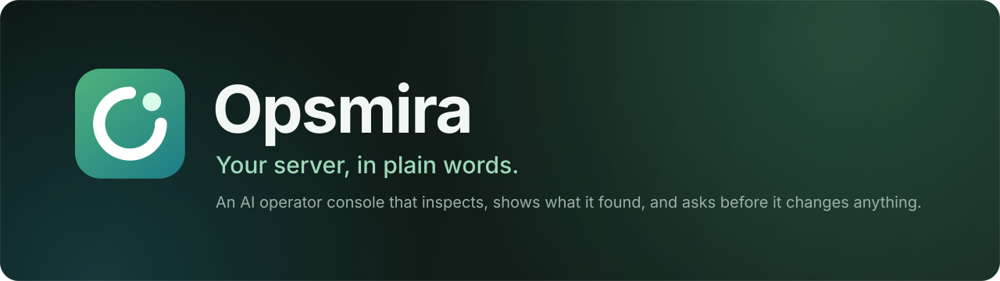
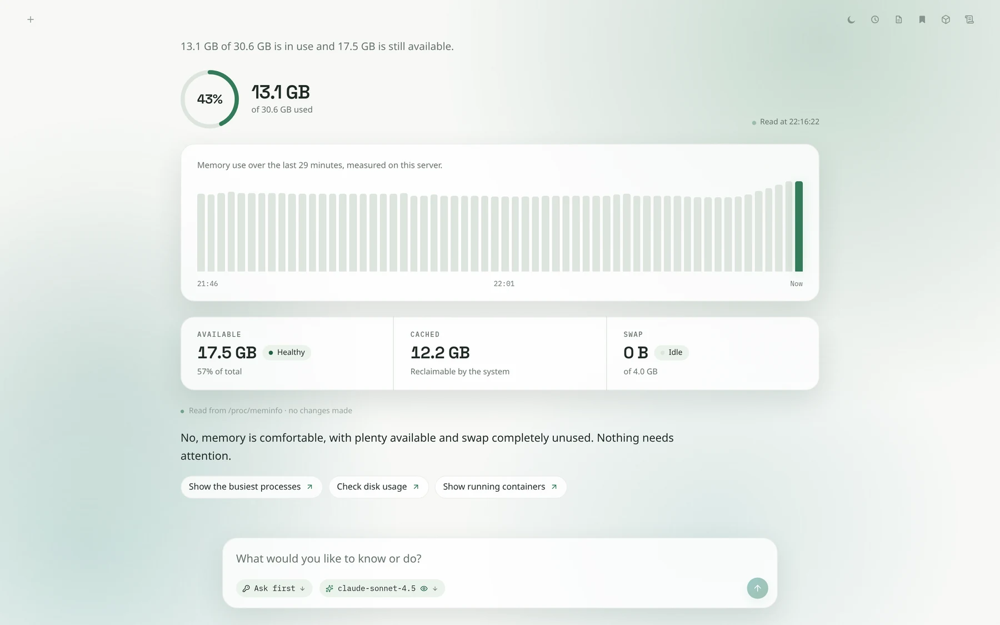
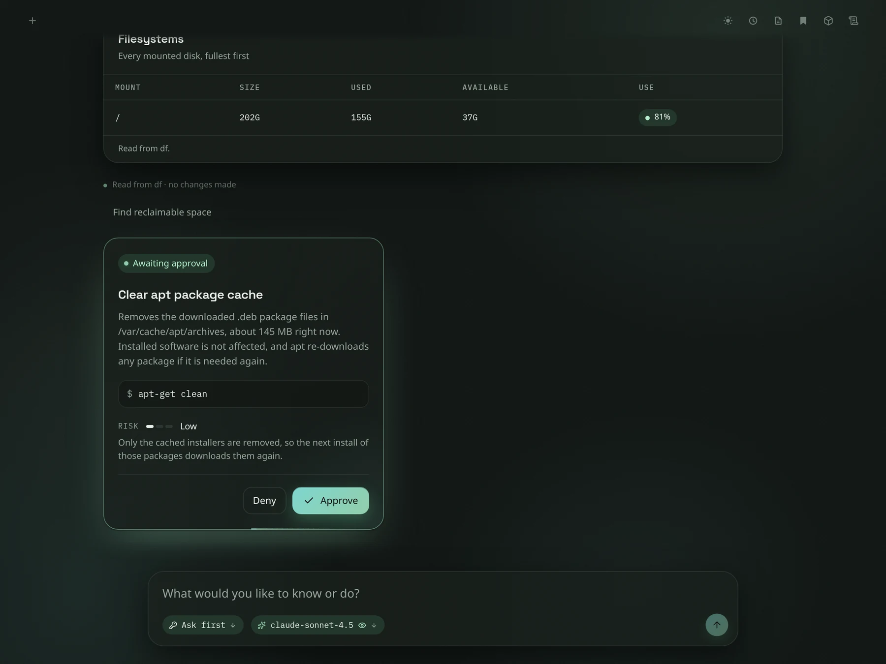
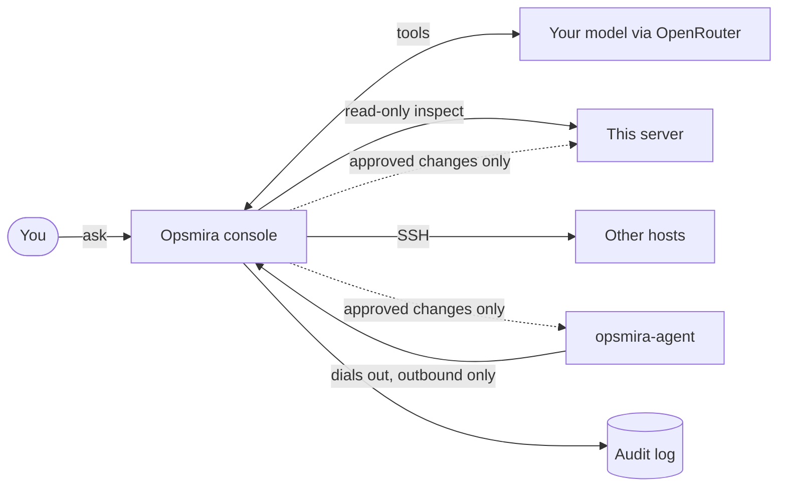

<div align="center">



<br>

[](https://github.com/DevBash1/opsmira/actions/workflows/ci.yml)
[](https://github.com/DevBash1/opsmira/releases)
[](LICENSE)
[](https://nodejs.org)
[](docs/self-hosting.md)
[](CONTRIBUTING.md)

**Ask a question about your server. Opsmira looks, shows you what it found, and asks before it changes anything.**

<br>

[](#quick-start)
[](docs/self-hosting.md)
[](docs/architecture.md)
[](ROADMAP.md)

<br>

<picture>
  <source media="(prefers-color-scheme: dark)" srcset="docs/assets/shot-hero.webp">
  
</picture>

</div>

<br>

> [!NOTE]
> Early software (v0.1). It works and is used daily, but expect rough edges. Anything that changes a machine
> waits for your approval, but read [SECURITY.md](SECURITY.md) before pointing it at something important.

## Why Opsmira

Running a server usually means remembering which command shows what, reading raw output, and hoping a
copied one-liner does what you think. Opsmira puts a conversation in front of that:

- **You ask in plain words.** "Why is the disk filling up?" "Is anything listening that shouldn't be?"
- **It investigates with read-only commands** and shows the answer as live visuals, not a wall of text.
- **It proposes the fix; you decide.** Each change is a card with what it does, how risky it is and the exact
  command. Nothing runs until you press Approve, and every action lands in an audit log.

<div align="center">



<sub>A proposed change: what it does, how risky it is, the exact command. You approve or deny.</sub>

</div>

## Features

| | |
| --- | --- |
| **Asks, then acts** | Read-only inspections run on their own. Changes are proposals you approve, and everything is audited. A Stop button cancels a turn in flight. |
| **Live surfaces** | Memory, CPU, network, disk, processes, logs, files, containers, services, schedules, TLS certificates, firewall exposure and storage cleanup, read from the real machine. |
| **Any server** | Manage other hosts over SSH, or have a server connect itself with one command: no SSH keys, no open port. [Details](docs/self-hosting.md#connect-a-server-without-ssh-agent). |
| **Agent-composed views** | For data no built-in surface covers, the agent builds a view from stats, tables, charts, logs and key-values, and says where the data came from. |
| **Memory and artifacts** | It remembers facts about your servers and keeps notes you can reopen. |
| **Bring your own model** | Any model on [OpenRouter](https://openrouter.ai), including your own provider keys (BYOK). |
| **Light and dark** | Responsive down to a phone, and it respects reduced motion. |

## Quick start

You need Node 20+ (or Docker) and an [OpenRouter key](https://openrouter.ai/keys).

```bash
git clone https://github.com/DevBash1/opsmira.git && cd opsmira
npm run setup                      # install web and server dependencies
cp .env.example server/.env        # then put your OPENROUTER_API_KEY in it
npm run build
npm start                          # http://127.0.0.1:8787
```

Open `http://127.0.0.1:8787` and sign in. The username is `admin` unless you set `OPSMIRA_USERNAME`; the
password is printed on first start and saved in `server/data/.admin-password` (or set `OPSMIRA_PASSWORD`).

<details>
<summary><b>With Docker</b></summary>

<br>

```bash
cp .env.example .env               # add OPENROUTER_API_KEY
docker compose up -d --build
```

Data lives in the `/data` volume. Tagged releases also publish an image to `ghcr.io/devbash1/opsmira`.

</details>

For HTTPS, running as a service, managing other servers and security advice, read
[docs/self-hosting.md](docs/self-hosting.md).

## Connect another server

Open **Surfaces → Connect a server** and run the command it shows on the machine you want to manage:

```bash
curl -fsSL https://your-console/agent/install.sh | sudo sh -s -- --server wss://your-console/api/agent/connect --token ops_connect_...
```

The agent dials out to your console, so the server needs no inbound port and you hand over no key. It is
**read-only by default**; add `--access operate` to let it run commands you approve. Revoking it from the
console disconnects it immediately.

## How it fits together



More in [docs/architecture.md](docs/architecture.md).

## Development

```bash
npm run setup
cp .env.example server/.env
npm run dev                        # web on :5173, server on :8787, both reload on change
npm run check                      # typecheck + server tests
```

Contributions are welcome: see [CONTRIBUTING.md](CONTRIBUTING.md) and the [Code of Conduct](CODE_OF_CONDUCT.md).
Pull requests need to agree to the [CLA](CLA.md). Changes are tracked in [CHANGELOG.md](CHANGELOG.md).

## Safety

Opsmira runs commands as the user it runs under. Read [SECURITY.md](SECURITY.md) before pointing it at
anything important, and never expose it to the internet without HTTPS.

## License

[AGPL-3.0-only](LICENSE). If you run a modified Opsmira as a service for other people, you must offer them
the source of your changes.
